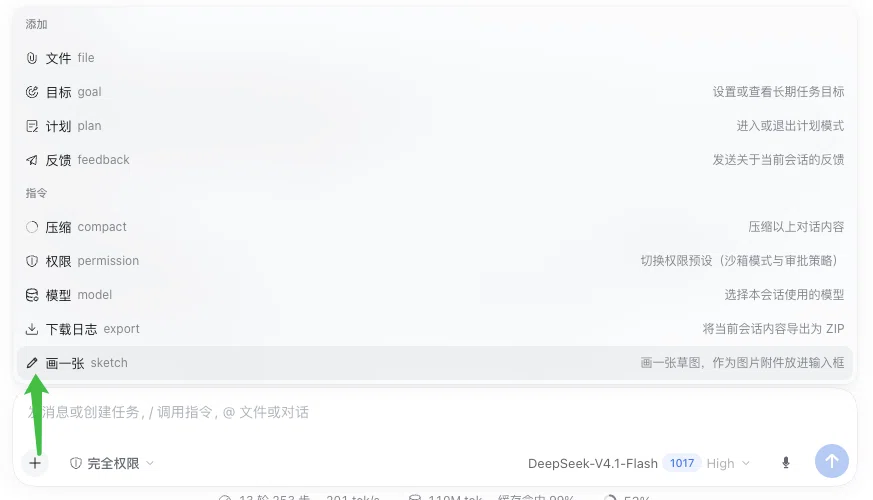
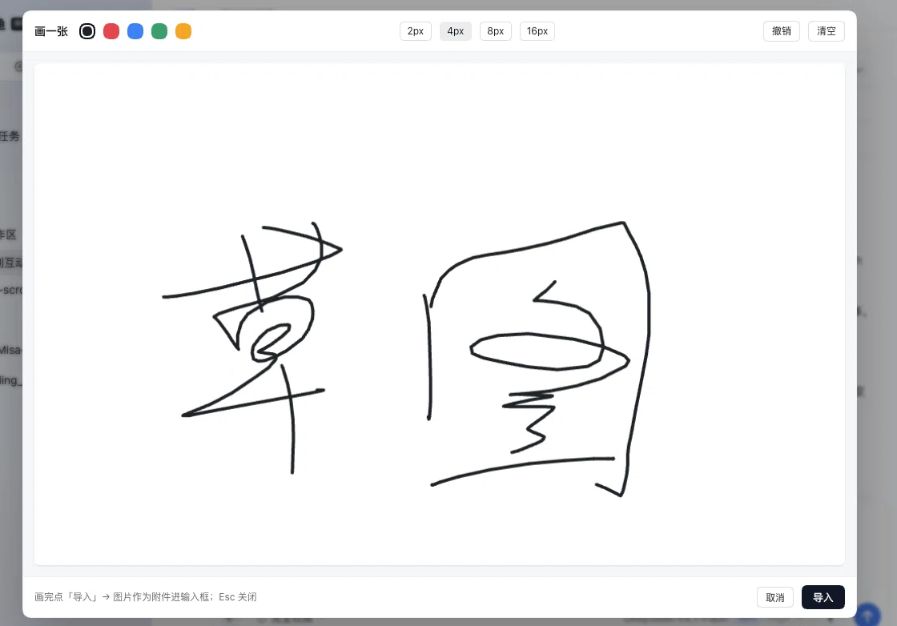
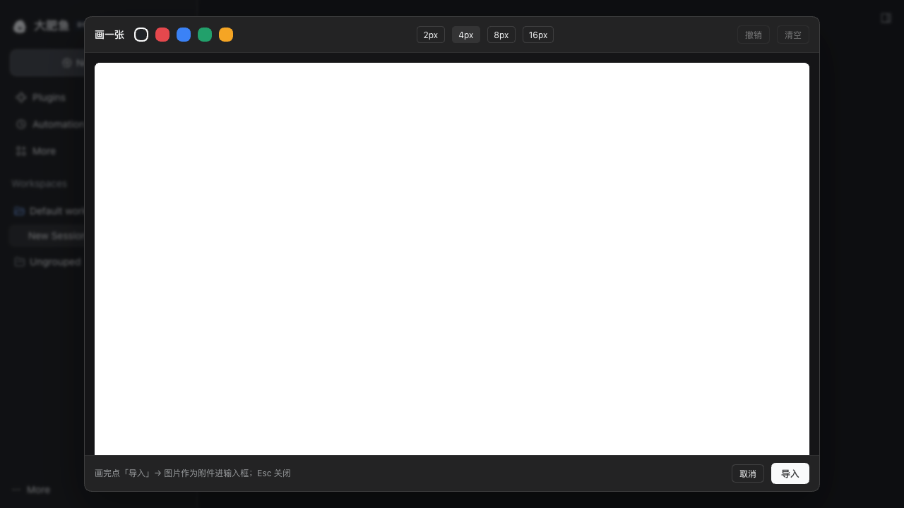

# 废弃

[bmhty123/dsh-sketchpad](https://github.com/bmhty123/dsh-sketchpad)这个更好用

# dsh-sketch

[](https://www.npmjs.com/package/dsh-sketch)
[](https://deepseek.com/harness)
[](./LICENSE)
[](https://dsh-plugin.org/plugins/dyguests/dsh-sketch)

> 输入框「+」菜单里的一个画板：**随手画一张，直接作为图片附件放进对话。**

DeepSeek Harness（dsh）插件。前身是 LLYlab 的 `dsh-sketch-draft` 1.0.0 —— 本仓库
**把图片交付从宿主 typert 端点改成纯客户端**，因为上游那套端点在 dsh 0.2.1 上已经
整条链失效（见下）。功能做减法之后，"draft"（往输入框草稿里写路径）这层语义也没了，
所以改名为 `dsh-sketch`。

> 上游的 GitHub 仓库 `LLYlab/DSHSketchDraft` **已经找不到了**，所以本仓库的第一个
> commit 是从 npm 上发布的包里取的，不是 clone 的 —— 详见「[源码来源](#源码来源)」。

- 上游 1.0.0 由 LLYlab 编写，MIT，见 [LICENSE](./LICENSE)
- 1.0.0 的源码取自 npm：<https://www.npmjs.com/package/dsh-sketch-draft>
  （`dsh-sketch-draft-1.0.0.tgz`，发布于 2026-09-29）
- 本仓库的改动见 [CHANGELOG.md](./CHANGELOG.md)；第一个 commit 是上游原样代码，
  之后的 commit 才是我改的，方便逐行对照

## 截图

**入口在输入框左下角的「+」菜单里**，和「文件 / 目标 / 计划」并列，右边是它的说明：



**点开就是画布**：5 种颜色、4 档线宽（2/4/8/16px），右上角撤销 / 清空，画完点「导入」：



**深色外观**下是同一套布局：面板、边框、按钮跟着主题走，只有画布保持白纸
（导出会进对话，深色底 + 黑笔在聊天里看不清）：



## 功能

- **入口**：输入框「+」菜单里的「画一张 / Sketch」，或直接输入 `/sketch`
- **画布**：5 种颜色、4 档线宽、撤销、清空；`Esc` 关闭，点遮罩也关
- **交付**：导出 PNG，作为**图片附件**放进输入框，紧接着就能发送
  （客户端 `conversation.createDrafts()` + `composer.addAttachments()`）
- **失败不撒谎**：附件通道被拒时退回**下载 PNG**，并在画布底部说明原因
- **跟随界面语言**：读宿主同步的 `<html lang>`，中文「画一张」/ 英文「Sketch」
- **深色外观**：颜色全部走宿主的主题 token（`--dsw-alias-*`），亮 / 暗两套自动适配；
  画布本身固定白纸
- **零依赖、纯客户端**：不需要宿主提供任何端点，宿主换传输层也不会整条链失效

---

## 上游在 dsh 0.2.1 上的问题

点「导入」时画布底部固定显示：

```
× 无法确认当前模型是否支持图片（support 端点不可用）：草图的落盘与交付方式无法判定
```

根因不在业务逻辑，在传输层。上游客户端这样调用宿主：

```js
connection.rpc.call("/api", "dshSketchDraft/support", { args: … })
```

而 dsh 0.2.1 的 RPC 在发出前会校验 endpoint：

```js
const ENDPOINT_SEGMENT_PATTERN = /^[A-Za-z0-9_$.-]+$/   // 不含 "/"
```

`dshSketchDraft/support` 命中斜杠，直接被 `assertTarget` 抛错，`support` 永远拿不到。
宿主半区那侧还注册在 typert 0.1.7 的协议上，改客户端一处也对不上，所以这个 fork
没有去修补传输，而是**换掉整条交付路径**。

---

## 与上游 1.0.0 的差异

| | 上游 1.0.0 | 本仓库 |
|---|---|---|
| 入口 | 输入框旁独立的铅笔按钮 | 「+」菜单里的一项（`/sketch` 也能触发） |
| 图片交付 | 宿主 `save` + 附件端点（typert） | 客户端 `conversation.createDrafts()` + `composer.addAttachments()` |
| 宿主半区 | 4 个 typert 端点（status/support/save/routes） | 空壳（只用来把包收进 profile 的 bundle 层） |
| 视觉模型判定 | 实时查模型表，不收图就自动切视觉模型，并给「切回」 | 不做判定，直接挂图片附件；附件失败时改为下载 PNG |
| PNG 落盘 | 总是写 `<workspace>/.dsh-drafts/*.png` | 不落盘，只进输入框 |
| 依赖 | `@deepseek-ai/dsh-typert-protocol`、`schemastery` | 无（零依赖） |

上游那套「实时判定 + 自动切模型」本身是好的设计，只是它依赖的传输层已经没了。
如果以后有人把 typert 端点按 0.2.x 重新接上，这块可以再补回来。

---

## 安装

```bash
# 从 npm 安装（推荐）
dsh plugin --profile web add dsh-sketch

# 或直接从 GitHub 源码
dsh plugin --profile web add github:dyguests/dsh-sketch

# 本地目录（改代码时用，改完不用重装）
dsh plugin --profile web add file:/absolute/path/to/dsh-sketch
```

装完**重启 dsh**（宿主半区只在启动时装载），刷新页面。

兼容：dsh `>=0.2.0`（`package.json` 的 `engines.dsh` 写的是 `>=0.2.0-0 <0.3.0`，
覆盖 0.2.x 的 prerelease）。纯前端插件，不挑平台。

## 用法

入口在输入框左下角那个「**+**」菜单里（和「文件 / 目标 / 计划」同一个菜单）：

1. 点「+」→ 在「指令」分组里选「**画一张**」；也可以直接输入 `/sketch`
   > 它在分组末尾，列表需要往下滚一点才看得到（「添加」分组是宿主写死的固定项，第三方插件只能进「指令」分组）
2. 画：5 种颜色、4 档线宽（2/4/8/16px）、撤销、清空，`Esc` 关闭（点遮罩也关）
3. 点「导入」→ 图片作为附件进输入框，紧接着就能发送
4. 万一附件通道被拒，会自动降级成**下载 PNG**，并如实说明，不假装成功

画布逻辑尺寸 1000×620；导出 PNG 是固定像素，与屏幕 DPR 无关，显示时按容器等比缩放。
菜单文案跟随界面语言（中文「画一张」/ 英文「Sketch」）。

## 已知边界

- **不判断模型是否收图**。当前模型不收图时，挂上去会在发送阶段被宿主拒绝，
  不会在画布阶段提前拦。
- **不落盘**。想要归档请在导入后自己保存，或改 `lib/client.js` 的 `deliver()`。
- 画布是自包含的预打包 bundle（`window.__ModuleLoader__.load` 的 lazy CJS 形态），
  改代码直接改 `lib/client.js`，不需要构建步骤。

## 源码来源

本仓库第一个 commit（`da88951`，原样上游代码）**不是从 GitHub clone 的**，而是取自
npm 上发布的包：

| 项目 | 值 |
|---|---|
| npm 页面 | <https://www.npmjs.com/package/dsh-sketch-draft> |
| 包文件 | `https://registry.npmjs.org/dsh-sketch-draft/-/dsh-sketch-draft-1.0.0.tgz` |
| 版本 / 发布 | `1.0.0`，2026-09-29 |
| 作者 / 许可 | LLYlab，MIT（`Copyright (c) 2026 LLYlab`） |

原因：**上游仓库 `LLYlab/DSHSketchDraft` 已经找不到了。**
`raw.githubusercontent.com` 对该仓库的任何文件都返回 404（`main`、`master` 两个分支
都试过），`github.com:443` 也连不通（`git ls-remote` 连了 75 秒后超时）。clone 不到
上游，就只能拿它发在 npm 上的包当基线 —— 这一版是发布产物，**正是 dsh 实际加载的
那份字节**，内容与已发布版本一致；代价是上游仓库里没有打进包的文件（例如它的单元
测试 `tests/sketch-draft.test.mjs`）这里也没有。

包里包含：`package.json`、`cordis.patch.yml`、`README.md`、`CHANGELOG.md`、`LICENSE`、
`lib/index.js`、`lib/client.js`。本仓库的目录结构与之一一对应。

## 许可

MIT。上游版权归 LLYlab（见 [LICENSE](./LICENSE)）；本仓库的改动保留同样的许可。
